

<picture><source media="(prefers-color-scheme: dark)" srcset="./assets/dark/banner.svg"></picture>

 

  

<picture><source media="(prefers-color-scheme: dark)" srcset="./assets/dark/highlights.svg"></picture>

 

<picture><source media="(prefers-color-scheme: dark)" srcset="./assets/dark/about.svg"></picture>

<picture><source media="(prefers-color-scheme: dark)" srcset="./assets/dark/divider.svg"></picture>

## Experience

<picture><source media="(prefers-color-scheme: dark)" srcset="./assets/dark/experience.svg"></picture>

## Volunteering

<picture><source media="(prefers-color-scheme: dark)" srcset="./assets/dark/volunteering.svg"></picture>

<picture><source media="(prefers-color-scheme: dark)" srcset="./assets/dark/divider.svg"></picture>

## Toolbox

<picture><source media="(prefers-color-scheme: dark)" srcset="./assets/dark/skills.svg"></picture>

<picture><source media="(prefers-color-scheme: dark)" srcset="./assets/dark/divider.svg"></picture>

## Featured projects

<table>
  <tr>
    <td width="50%"><picture><source media="(prefers-color-scheme: dark)" srcset="./assets/dark/project-campuspilot.svg"></picture></td>
    <td width="50%"><picture><source media="(prefers-color-scheme: dark)" srcset="./assets/dark/project-saarthi.svg"></picture></td>
  </tr>
  <tr>
    <td width="50%"><a href="https://github.com/YanaParikh04/TapLock"><picture><source media="(prefers-color-scheme: dark)" srcset="./assets/dark/project-taplock.svg"></picture></a></td>
    <td width="50%"><a href="https://github.com/YanaParikh04/JalKrishi-AI"><picture><source media="(prefers-color-scheme: dark)" srcset="./assets/dark/project-jalkrishi.svg"></picture></a></td>
  </tr>
  <tr>
    <td width="50%"><a href="https://github.com/YanaParikh04/ATSIQ"><picture><source media="(prefers-color-scheme: dark)" srcset="./assets/dark/project-atsiq.svg"></picture></a></td>
    <td width="50%"></td>
  </tr>
</table>

<picture><source media="(prefers-color-scheme: dark)" srcset="./assets/dark/divider.svg"></picture>

## Certifications and achievements

**Awards:** Best Oral Presentation at SICARSTM 2026 · Top 4 Finalist at InnoFest 2024

| Google and Kaggle | IBM SkillsBuild | Other |
| :-- | :-- | :-- |
| Google AI Essentials Specialization | Agentic AI: From Learner to Builder | Foundation Course on AI Readiness, IICT |
| Google Prompting Essentials | Prompt Engineering | Graduation Employability Enhancement Training, Infosys Foundation |
| Kaggle 5-Day AI Agents Intensive (Vibe Coding) | | |

<picture><source media="(prefers-color-scheme: dark)" srcset="./assets/dark/divider.svg"></picture>

## GitHub activity

<picture><source media="(prefers-color-scheme: dark)" srcset="./assets/dark/contributions.svg"></picture>

<picture><source media="(prefers-color-scheme: dark)" srcset="./assets/dark/languages.svg"></picture>

<picture><source media="(prefers-color-scheme: dark)" srcset="./assets/dark/divider.svg"></picture>

## Right now

<picture><source media="(prefers-color-scheme: dark)" srcset="./assets/dark/now.svg"></picture>

 

  

<picture><source media="(prefers-color-scheme: dark)" srcset="./assets/dark/footer.svg"></picture>

