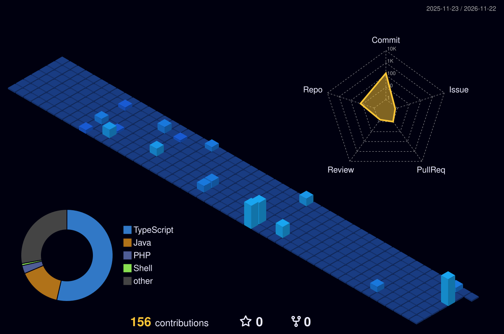

 

---

## About

I'm an Information Technology student at Sigma University (Vadodara, India) working where AI, software development and real-world problem solving meet. I like turning an idea into a working product, and I spend my time on AI agents, Generative AI, automation and Android apps. I also help run student tech communities.

- 🎓 B.Tech in Information Technology, Sigma University
- 🤖 Exploring Generative AI, AI agents and automation
- 📱 Building Android apps and AI-powered products
- 🌐 Google Student Ambassador 2026 and Google Product Expert
- ☁️ AWS Student Builder Group Leader at Sigma University

## Experience and community

| Role | Organization |
| :-- | :-- |
| Google Student Ambassador 2026 | Google |
| Google Product Expert | Google |
| Student Builder Group Leader | AWS |
| AI Automation and Intelligent Solutions Intern | IBM SkillsBuild · AICTE · CSRBOX |
| AI Strategy and Business Intelligence Intern | IBM SkillsBuild · AICTE · CSRBOX |

## Tech stack

 

  

## Featured projects

<table>
  <tr>
    <td width="50%" valign="top">
      <h3>CampusPilot</h3>
      A student companion built around specialised AI agents: Planner, Tutor, Quiz, Motivation and Focus Guardian.  
      
      
      
    </td>
    <td width="50%" valign="top">
      <h3>Saarthi</h3>
      An AI-assisted solution in development, focused on multilingual interaction, accessibility and offline data sync.  
      
      
      
    </td>
  </tr>
  <tr>
    <td width="50%" valign="top">
      <h3><a href="https://github.com/YanaParikh04/TapLock">TapLock</a></h3>
      A lightweight Android app that locks the screen with a single tap, using the Device Administration API.  
      
      
    </td>
    <td width="50%" valign="top">
      <h3><a href="https://github.com/YanaParikh04/JalKrishi-AI">JalKrishi AI</a></h3>
      Built during my IBM learning and internship journey, exploring technology-driven agricultural solutions.  
      
      
    </td>
  </tr>
  <tr>
    <td colspan="2" valign="top">
      <h3><a href="https://github.com/YanaParikh04/ATSIQ">ATSIQ</a></h3>
      Exploring AI-assisted resume and applicant tracking workflows.
    </td>
  </tr>
</table>

## Certifications and achievements

- 🏆 Best Oral Presentation, SICARSTM 2026
- 🏆 Top 4 Finalist, InnoFest 2024
- 📜 Google AI Essentials Specialization
- 📜 Google Prompting Essentials
- 📜 Kaggle 5-Day AI Agents Intensive (Vibe Coding)
- 📜 IBM SkillsBuild: Agentic AI, From Learner to Builder
- 📜 IBM SkillsBuild: Prompt Engineering
- 📜 Foundation Course on AI Readiness, IICT
- 📜 Graduation Employability Enhancement Training, Infosys Foundation

## GitHub activity

  

<!-- Generated daily by .github/workflows/profile-3d.yml -->

 

## Let's connect

I'm always happy to meet people building meaningful products, whether that's developers, community leaders or fellow students.

  

