 

  

 

## Where I contribute

## Toolbox

## Featured projects

<table>
  <tr>
    <td width="50%"></td>
    <td width="50%"></td>
  </tr>
  <tr>
    <td width="50%"></td>
    <td width="50%"></td>
  </tr>
  <tr>
    <td width="50%"></td>
    <td width="50%"></td>
  </tr>
</table>

## Certifications and achievements

**Awards:** Best Oral Presentation at SICARSTM 2026 · Top 4 Finalist at InnoFest 2024

| Google and Kaggle | IBM SkillsBuild | Other |
| :-- | :-- | :-- |
| Google AI Essentials Specialization | Agentic AI: From Learner to Builder | Foundation Course on AI Readiness, IICT |
| Google Prompting Essentials | Prompt Engineering | Graduation Employability Enhancement Training, Infosys Foundation |
| Kaggle 5-Day AI Agents Intensive (Vibe Coding) | | |

## Activity

<!-- Generated daily by .github/workflows/profile-3d.yml -->

 

  

  

